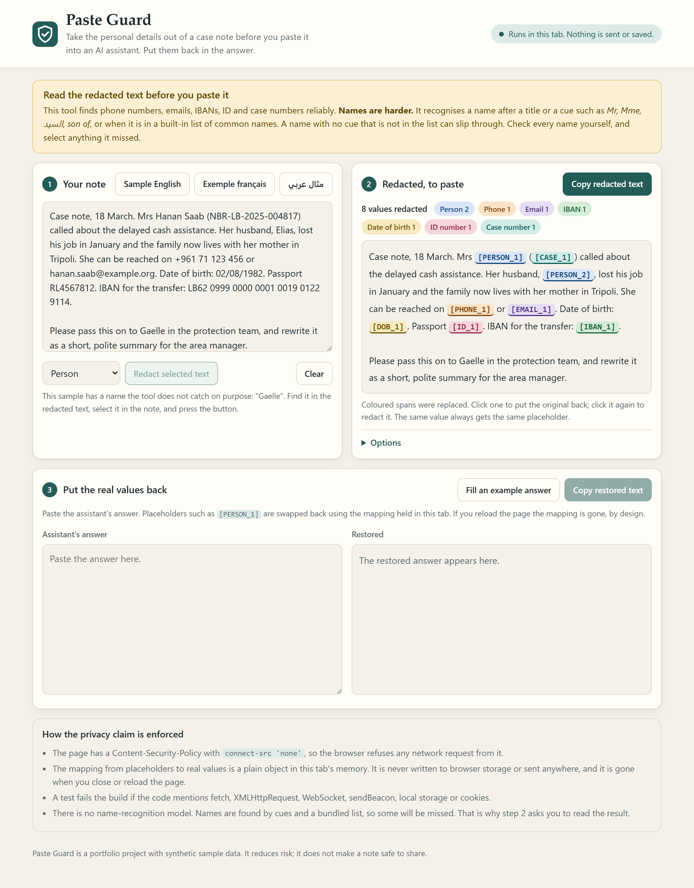

# Paste Guard

Strips names, phone numbers and ID numbers out of case notes in the browser before they are pasted into an AI assistant, and puts them back in the answer.

**Live demo:** https://tonihaddad.github.io/paste-guard/



## The need

Staff want an AI assistant's help to rewrite a case note or summarise a complaint. The note contains a beneficiary's name, phone number and registration number. Policy says do not paste personal data; in practice people paste it. This gives them a safe way to do what they were going to do anyway: redact in one click, paste the redacted text, then restore the real values in the answer.

It is one HTML page and plain JavaScript. No framework, no build step, no CDN, no server logic. It works offline and makes no network request after it loads.

## Try it

```
npm start
```

```
Paste Guard on http://127.0.0.1:8109/  (Ctrl+C to stop)
```

Open that address and press a sample button. Opening `index.html` directly also works. There is nothing to install: Node 20 or newer is the only requirement. `npm test` runs the tests, `npm run bench` runs the benchmark.

## How it works

| Step | What happens |
|---|---|
| 1. Paste a note | `src/detect.js` finds personal data. It has no DOM dependency, so Node tests it directly. |
| 2. Read the redacted text | Each value becomes a stable placeholder such as `[PERSON_1]` or `[PHONE_2]`. The same value always gets the same placeholder in a session, so the text still makes sense to the assistant. Click a coloured span to put the original back. Select any text and press the button to redact it too. |
| 3. Paste the answer back | Placeholders in the assistant's answer are swapped for the real values. Lost brackets and case changes are tolerated. |

What is detected:

- **Phones**: Lebanese, Kenyan, Colombian and international formats, with Arabic-Indic digits. The same number written two ways gets one placeholder.
- **Emails, IBANs** (length check per country, checksum otherwise).
- **Dates of birth**, only after a cue (born, DOB, née le, تاريخ الميلاد, من مواليد). An ordinary visit date is left alone.
- **ID and passport numbers**, after a cue (passport, carte d'identité, cédula, رقم الهوية, UNHCR number) or in the shape of a passport number.
- **Case and registration numbers** in a **fictional** format invented for this project: `NBR-LB-2024-004817` (file) and `HH-KE-33012` (household). No real agency uses it.
- **Names.** There is no name-recognition model. The detector combines:
  - cues: titles (Mr, Mrs, Dr, Mme, M., Madame, السيد, السيدة, الدكتورة), relations ("son of", "fils de", "زوجها", "her cousin Nayla"), labels ("Caller:", "المستفيد:"), kunya (أبو خالد, Umm Ali);
  - a bundled list of about 1,300 common Arabic, English, French, Swahili and Spanish given and family names, in Latin and Arabic script (`src/gazetteer.js`);
  - your own list of extra names, in any script;
  - repeat finding: once a name is found, its other mentions, including a first name alone, are found too;
  - an optional strict mode that redacts every capitalised word that does not start a sentence.

Words such as "hope" or "نور" are also names, so they only count next to another name or after a cue.

## The privacy claim, and how it is enforced

- The page carries a Content-Security-Policy with `connect-src 'none'`: the browser itself refuses any network request from it. I checked it from `file://` and over HTTP, offline after load, and the browser made no request other than the page's own files.
- The mapping from placeholders to real values is a plain `Map` in the page's memory. It is never written to browser storage and is gone when the tab closes.
- `tests/no-network.test.js` fails the build if the shipped code mentions fetch, XMLHttpRequest, WebSocket, sendBeacon, local or session storage, cookies, IndexedDB, eval and similar. It also checks that the CSP is present, that every script is a local file with no inline code, and that the page loads nothing from outside.

This is evidence for the code in this repo. It does not protect text after you paste it into an assistant, which is the point of redacting it first.

## Results

The benchmark is 60 synthetic case notes about fictional Northbridge Relief casework: 20 each in English, French and Arabic, 229 labelled entities. `npm run bench` prints the tables below. Recall is the number that matters, because a missed name is a leak.

- **Recall** = share of labelled entities that are fully covered by detected spans. A name with its surname left behind counts as missed.
- **Precision** = share of detected spans that overlap a labelled entity of the same type.

```
RECALL AND PRECISION, ALL NOTES, BY ENTITY TYPE
group           gold  found  recall  preds correct precision
PERSON           128    110   85.9%    113     112   99.1%
PHONE             36     36  100.0%     36      36  100.0%
EMAIL             11     11  100.0%     11      11  100.0%
IBAN               4      4  100.0%      4       4  100.0%
DOB               15     15  100.0%     15      15  100.0%
ID                16     16  100.0%     16      16  100.0%
CASE              19     19  100.0%     19      19  100.0%
ALL              229    211   92.1%    214     213   99.5%

BY LANGUAGE
group           gold  found  recall  preds correct precision
en                82     76   92.7%     77      76   98.7%
fr                77     72   93.5%     72      72  100.0%
ar                70     63   90.0%     65      65  100.0%

BY SPLIT
group           gold  found  recall  preds correct precision
dev              111    110   99.1%    110     110  100.0%
heldout           60     58   96.7%     59      58   98.3%
stress            58     43   74.1%     45      45  100.0%

PERSON ONLY, BY LANGUAGE AND SPLIT
group           gold  found  recall  preds correct precision
en dev            17     17  100.0%     17      17  100.0%
en heldout        11     10   90.9%     11      10   90.9%
en stress         17     12   70.6%     12      12  100.0%
fr dev            21     20   95.2%     20      20  100.0%
fr heldout        12     11   91.7%     11      11  100.0%
fr stress         11      8   72.7%      8       8  100.0%
ar dev            19     19  100.0%     19      19  100.0%
ar heldout        10     10  100.0%     10      10  100.0%
ar stress         10      3   30.0%      5       5  100.0%

STRICT MODE, PERSON ONLY, STRESS SPLIT
group           gold  found  recall  preds correct precision
en stress         17     16   94.1%     18      16   88.9%
fr stress         11     10   90.9%     12      10   83.3%
ar stress         10      3   30.0%      5       5  100.0%
```

The full output, including every miss and by-language-and-type tables, is in `docs/benchmark-output.txt`.

### How to read these numbers

- **Structured identifiers are reliable on this data**: all 101 phones, emails, IBANs, dates of birth, ID numbers and case numbers were found. The notes use the formats the detector was built for, so this is a measure of the patterns, not a promise about every format in the field.
- **Names are the weak point.** Names reached 96.7% recall on the notes I tuned on and the held-out notes, and **60.5% (23 of 38) on the stress notes**. The honest estimate for real notes, which have more unusual names and fewer titles, is the stress figure or worse.
- **The notes are small and written by me**, the same person who wrote the detector and the name list. They are not real case notes.
- **How the splits were made.** I wrote the notes in three groups. *dev* (10 per language) was used while building. *heldout* (5 per language) was scored first, and then I fixed five generic bugs that its misses exposed (a possessive "Khaled's", "date of birth is", "cédula as", "الأرملة", a kunya span), so it is only partly held out. *stress* (5 per language) is informal, cue-poor and full of uncommon names; I wrote it after tuning and have not tuned on it.
- **What the first run looked like.** The first measurement (45 notes) is kept in `bench/first-run.txt`: 84.2% overall, names 73.3%. An even earlier run scored 92%, but the name list then contained names I had planned for the notes, so I removed them. I also made the French notes harder after they scored 100%, because they were too cue-heavy to tell me anything.
- **Strict mode** lifts English and French stress recall for names to 94% and 91%, at the cost of precision (89% and 83%), because place and organisation names get caught too. It does nothing for Arabic: no capital letters.

## Where it fails

Names with no cue, that are not in the list, are missed. Real misses from the benchmark (`npm run bench`, section "MISSED"):

| Note | Missed | Why |
|---|---|---|
| en-16 | `Gaelle` ("pass this to Gaelle in protection") | no title, not in the list, nothing before it |
| en-17 | `Mercy Kerubo` (start of a sentence) | uncommon name, and sentence-initial capitals look like any other word |
| en-12 | `Wilmer` ("The child's father is Wilmer") | the cue is a copula, not "son of" or a title |
| fr-16 | `Hagop` ("Contact : Hagop, 71 556 903") | the number after him is caught, his name is not |
| fr-20 | `Bertille` | uncommon given name, no cue |
| ar-16 | `تيماء` | unknown name, and Arabic has no capital letters to hint at it |
| ar-18 | `أم كنان` | a kunya is only recognised when the name after it is in the list |
| ar-19 | `نجلاء قصّار` after السيدة | a crude rule that treats unknown words starting with ن, ي or ت as verbs, so the name is skipped |
| ar-17 | `نبيل` ("شقيقه نبيل", his brother Nabil) | I forgot the form شقيقه in the relation list; left unfixed because the stress notes are not tuned on |
| ar-17 | surname of `عماد الدين شرارة` | the cue captures the first name, then stops at الدين |

Arabic is weakest (30% name recall on the stress notes) for a structural reason: without capital letters the tool cannot tell an unknown name from a noun. Precision on the benchmark is high, but that is partly because unknown words are simply left alone.

**What the page tells the user.** A yellow notice above the work area says: read the redacted text before you paste it, names are harder than numbers, and a name with no cue that is not in the list can slip through. The English sample contains such a name on purpose ("Gaelle") and the page asks the user to find it and select it. Strict mode and the extra names list are the two ways to catch more.

Other limits: a first name and the full name get separate placeholders unless the first name was found as part of the full name's repeat search; a typo in a name is not matched; scanned images and PDFs are out of scope; the Arabic coverage is Levantine-leaning, as is the name list.

## Tests

`npm test` runs 42 tests with Node's built-in runner (`node --test`), also in GitHub Actions on Node 20 and 22:

- detection for each type and format, including Arabic-Indic digits, non-phone numbers that must be left alone, and spans that must never overlap;
- redaction: stable placeholders, restore round trip on every benchmark note, un-redact, assistant-mangled placeholders;
- the no-network and no-storage guard described above;
- benchmark floors: every structured identifier found, name recall floors, precision floor, strict mode beats default.

## What I would add next

- Run a small on-device name model (for example a quantised NER model in the browser) as an extra layer for names with no cue, and measure it on the same stress notes.
- Let the user save their extra-names list as a file they control, so it survives a reload without the page storing anything itself.

## Licence

MIT. See `LICENSE`. All sample data is synthetic; Northbridge Relief is fictional.
